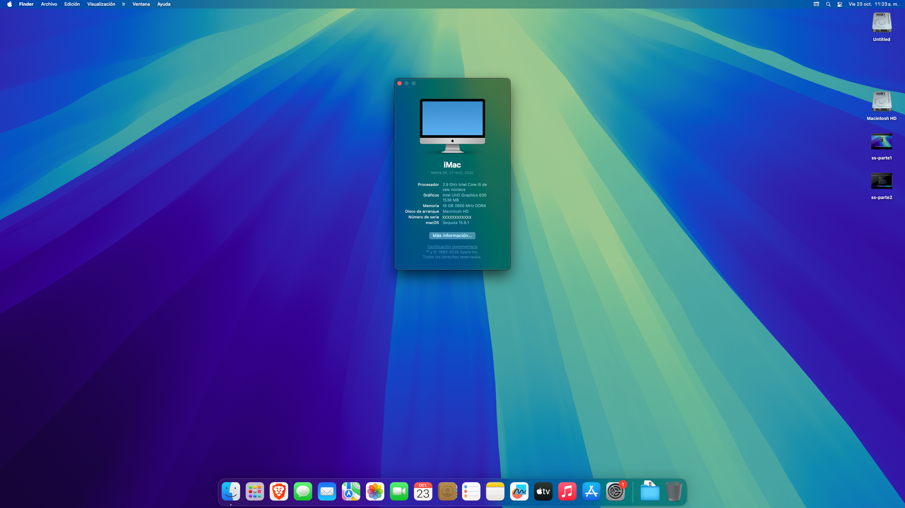
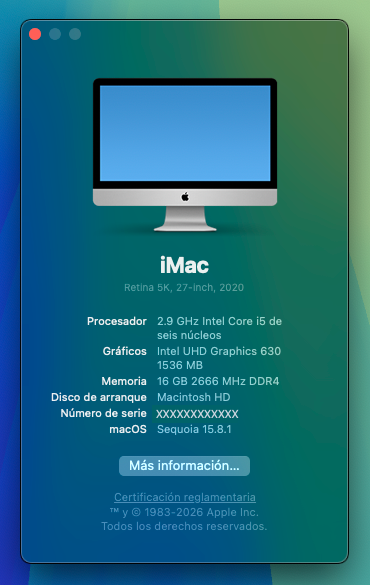
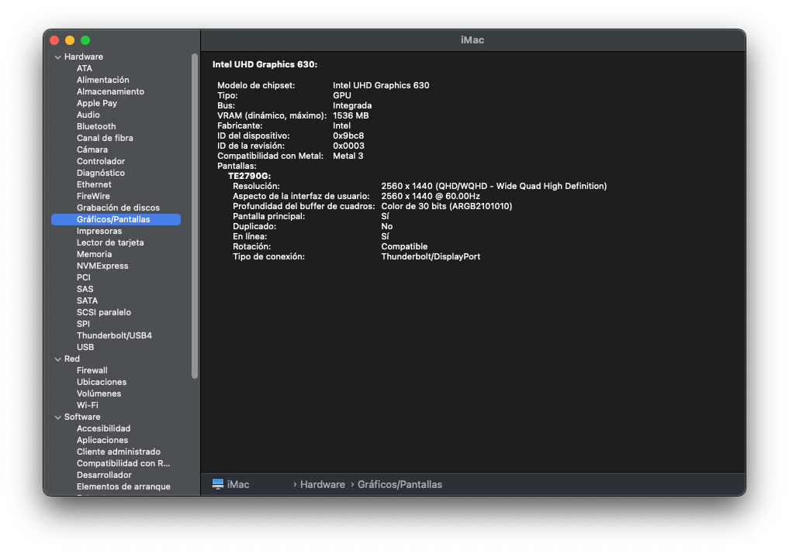

# Hackintosh EFI – ASUS PRIME B460M-A R2.0 + i5-10400 (UHD 630)

EFI de OpenCore para macOS 15 Sequoia en un PC de escritorio Comet Lake usando solo la gráfica integrada.

> ⚠️ Este EFI **no incluye números de serie**. Antes de usarlo tienes que generar tu propio SMBIOS (ver abajo).

## Capturas

| Acerca de este Mac | Gráfica (UHD 630 con aceleración) |
|:---:|:---:|
|  |  |

## Hardware

| Componente | Modelo |
|---|---|
| Placa base | ASUS PRIME B460M-A R2.0 (BIOS 3005) |
| CPU | Intel Core i5-10400 (Comet Lake) |
| Gráfica | Intel UHD Graphics 630 (iGPU, `0x9BC8`) |
| Monitor | 2560×1440 por **HDMI** |
| Audio | Realtek ALC897 |
| Ethernet | Intel I219-V |
| Disco | Kingston NV1 NVMe 500 GB |

## Software

- macOS 15 Sequoia
- OpenCore 1.0.9 (build de desarrollo) con menú gráfico OpenCanopy (tema GoldenGate)
- SMBIOS: `iMac20,1`
- SIP activada y arranque seguro de Apple (`SecureBootModel = Default`)

## Estado

| Función | Estado |
|---|---|
| Aceleración gráfica (1536 MB, Metal 3) | ✅ |
| HDMI a 2560×1440 @ 60 Hz | ✅ |
| Ethernet | ✅ |
| USB 3 traseros | ✅ |
| Gestión de energía de la CPU | ✅ |
| Audio de la placa (layout-id 99) | Detectado, sin probar a fondo |
| Reposo y despertar con el teclado | ✅ |

## Notas importantes

### HDMI en la UHD 630
OpCore Simplify pone `-igfxvesa` cuando el monitor va por HDMI, lo que deja la gráfica sin aceleración (3 MB, 1024×768). Aquí está quitado y se usa este parche en `DeviceProperties → PciRoot(0x0)/Pci(0x2,0x0)`:

- `AAPL,ig-platform-id` = `07009B3E`
- `framebuffer-con0-alldata` = `01010900 00080000 C7030000`. Es el puerto B en modo HDMI con **busId 0x01**. El valor original 0x05 deja la pantalla en negro en chipsets serie 400.
- `framebuffer-con1/con2` desactivados (busId `00`)
- `enable-hdmi-dividers-fix` = `01000000` (monitores 2K/4K por HDMI 1.4)

Si tu monitor está en otro puerto (DVI) tendrás que adaptar el conector.

### Arranque dual con Windows
Windows está en un segundo disco y aparece en el menú de OpenCore. `LauncherOption = Full` registra OpenCore como primera opción de arranque en la BIOS, para que una actualización de Windows no lo desplace.

Si instalas Windows, desconecta antes el disco de macOS. Así Windows crea su propia partición EFI en lugar de usar la de macOS.

### Capturas del menú de arranque
`CrScreenshotDxe.efi` está activado: pulsa **F10** en el menú de OpenCore para guardar una captura en la raíz de la partición EFI.

### Mapa USB
`UTBMap.kext` (USBToolBox) con 11 puertos: los 4 USB 3 traseros, 2 USB 2.0 traseros y el puerto 12 (USB 2.0 frontal). Si tu caja tiene otros puertos frontales, rehaz el mapa con [USBToolBox](https://github.com/USBToolBox/tool).

## Antes de usar este EFI

1. **Genera tu SMBIOS** con [GenSMBIOS](https://github.com/corpnewt/GenSMBIOS) o [OpCore Simplify](https://github.com/lzhoang2801/OpCore-Simplify) para `iMac20,1`. Rellena en `config.plist → PlatformInfo → Generic`:
   - `SystemSerialNumber`
   - `MLB`
   - `SystemUUID`
   - `ROM` (puedes usar la MAC de tu tarjeta de red)

   Comprueba en [checkcoverage.apple.com](https://checkcoverage.apple.com) que el serial **no sea válido**, para no usar el de un Mac real.
2. **BIOS**: desactiva CSM, Fast Boot y Secure Boot. Activa Above 4G Decoding y pon el modo SATA en AHCI.
3. Si actualizas OpenCore, cambia también `OpenCanopy.efi` a la misma versión, o el menú volverá a modo texto.

## Créditos

[Acidanthera](https://github.com/acidanthera) (OpenCore, Lilu, WhateverGreen, AppleALC, VirtualSMC…), [Dortania](https://dortania.github.io/) (guías), [OpCore Simplify](https://github.com/lzhoang2801/OpCore-Simplify), [USBToolBox](https://github.com/USBToolBox).
